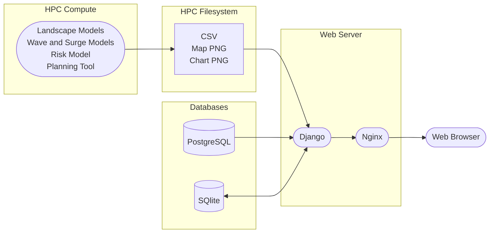
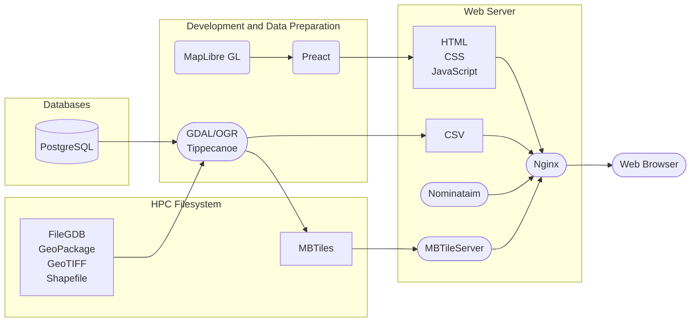
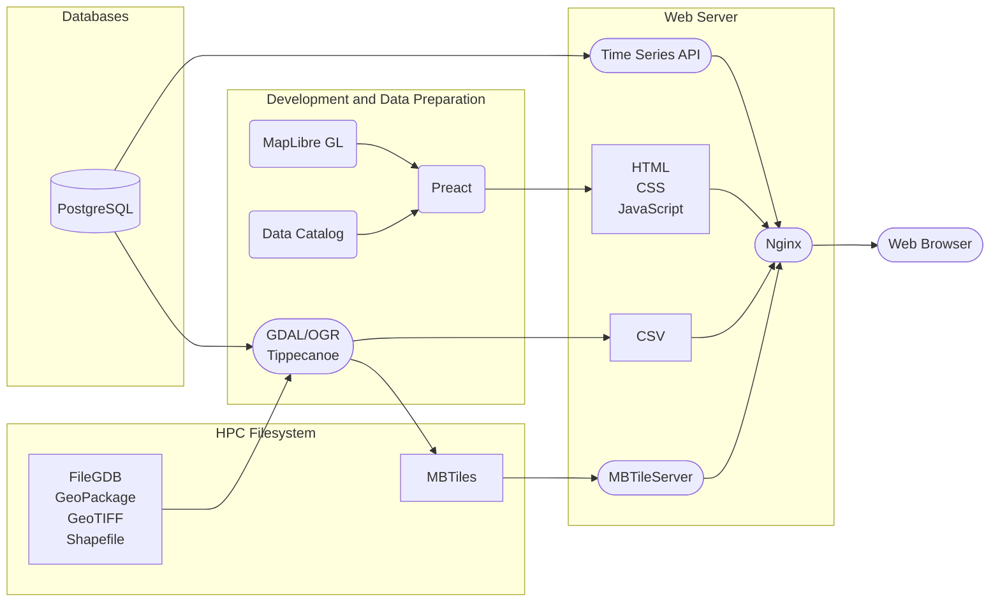

# 2023 Coastal Master Plan Technical Summary

Starting in 2020, the Pittsburgh Supercomputing Center (PSC) collaborated with the Coastal Protection and Restoration Authority (CPRA) to develop three online portals in support of Louisiana’s 2023 Coastal Master Plan. This document summarizes the software we developed as part of this collaboration and the ongoing efforts to extend and enhance it for the 2029 Master Plan.

## Quality Assurance/Quality Control (QA/QC) Portal

We first developed a [Quality Assurance and Quality Control (QA/QC) Portal](https://mp2023.bridges2.psc.edu/) to aid the research team in checking intermediate model outputs from simulation runs. This portal was built to transition the existing spreadsheet-based quality control into a centralized resource where users could review all results and commentary in one location. By doing so, the QA/QC process became simpler, and users were able to focus on the data rather than the communication and collaboration processes surrounding QA/QC.

The QA/QC Portal allowed the research team to create custom workflows that were assignable to users and teams. It also included the ability to assign users to certain sets of results based on team membership, which was an important part of the existing QA/QC routines. The portal was built with flexibility in mind, allowing users to access as much data as possible. This flexibility was important, as teams needed to be able to see other teams’ data for analysis.

The portal was designed to operate directly on model output files, such as CSVs and images, rather than ingesting them into a central data store. It also consumed project and model run data from the Project Development Database (PDD) and workflow information from its own SQLite database. Implemented in Django, the portal application was served by an Nginx web server.

## Master Plan Data Viewer

Starting in early 2022, we developed a public portal for visualizing projects and model results. The [Master Plan Data Viewer](https://mpdv.coastal.la.gov/) includes interactive maps and narrative elements that allow users to explore the changes in the coastal environment under several possible future scenarios. Using interactive controls, users can change factors like the environmental scenario, plan implementation scenario, and year, and see the resulting impacts on the map.

The data viewer is built on popular open source libraries and frameworks such as GDAL/OGR, MapLibre GL, and Nominatim, and is designed to optimize simplicity and performance. As such, all of the data sources–such as data from the PDD and file-based geospatial formats–were pre-tiled during the development phase. This allows for a simple server architecture, where the only dynamic components are a tile server and a geocoder. The rest of the application consists of static files that are served directly to the browser by the Nginx web server.

## Master Plan Data Access Portal

During 2023, we collaborated with the CPRA research team on a third software tool, the [Master Plan Data Access Portal](https://mpdap.coastal.la.gov/). Designed to allow researchers to visualize and download data from the master plan process, the portal includes a wider range of datasets and visualization types than the data viewer. Like the data viewer, it is built on a foundation of open source software and optimized for ease of use and performance.

The architecture of the data access portal differs from that of the data viewer in two key areas. First, it introduces a time series API that provides data for the interactive map and charts. This API consumes model outputs from the PDD and serves them as JSON and CSV files for use in the portal and in data downloads, respectively. It allows users to retrieve data for multiple scenarios in a single request, reducing the number of API calls needed and improving performance.

The data access portal also includes a more sophisticated internal catalog than the data viewer, allowing it to track the combinations of variables that are available. This catalog allows the user interface to dynamically adjust the hierarchy of options presented to the user and avoid showing invalid combinations of variables for which data are not available.

