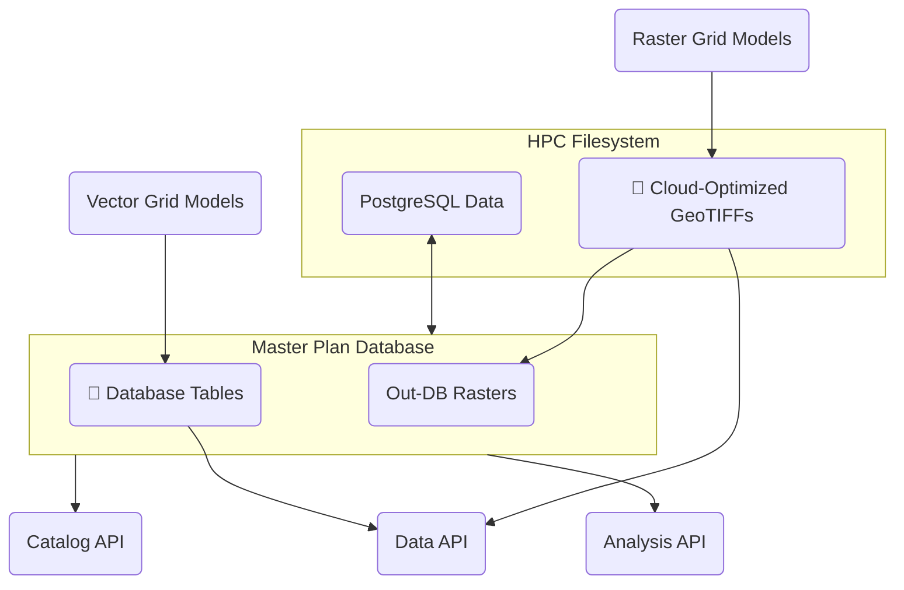
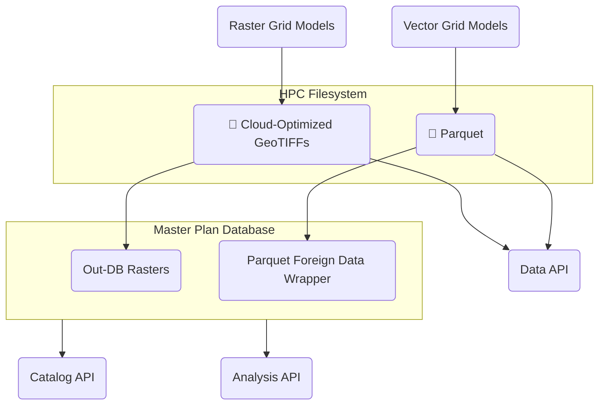
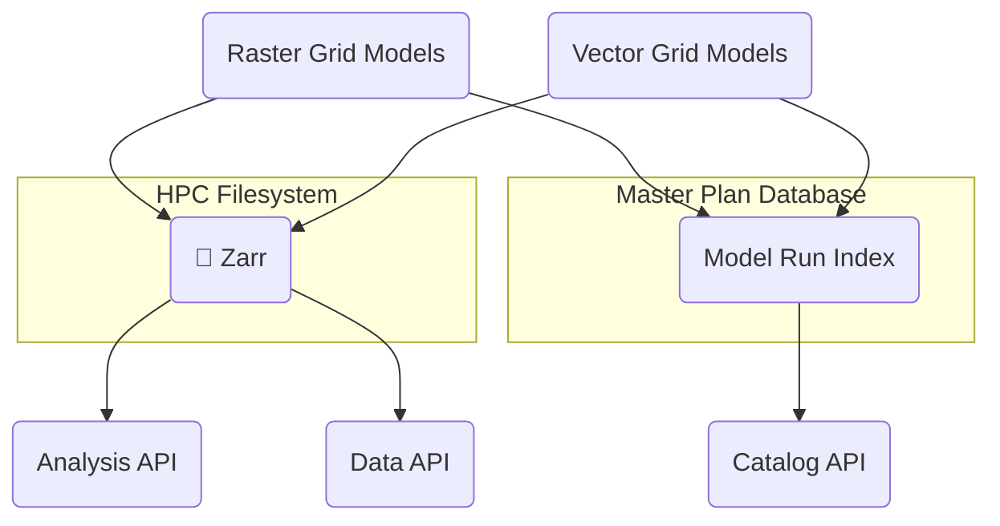
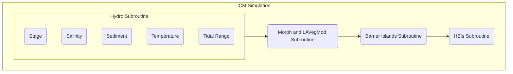
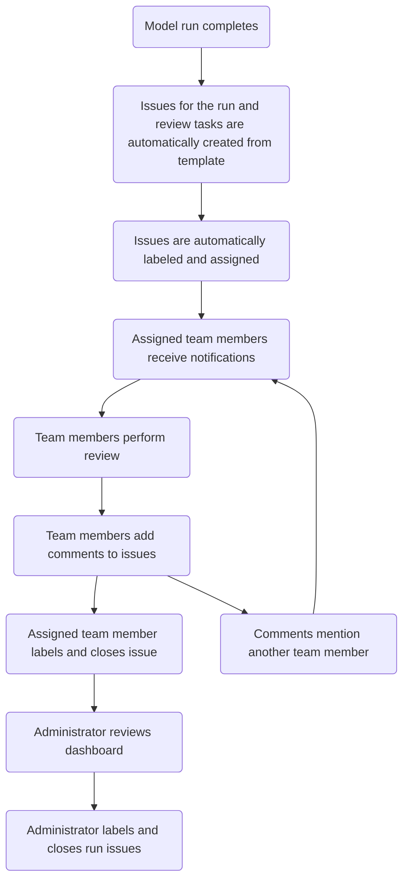

# Master Plan 2029 Technical Requirements

## Background

### Types of Master Plan Data

The master plan development process generates data of several types. These include:

- **Vector geometries** are used to represent model grids and project alignments.
- **Vector attributes** represent project attributes as well as grid cell values for model inputs and outputs.
- **Raster images** are used to represent some model inputs and outputs.

### Audience Groups

Data from the 2029 Master Plan will be used by a variety of stakeholders during and after the development of the plan:

- **Modeling Teams:** The modeling teams include CPRA staff and contractors responsible for data preparation, modeling, and quality assurance.
- **Strategy Team:** The strategy teams includes CPRA staff who provide direction to the planning process and oversee modeling, public engagement, and plan document preparation.
- **Advisory Groups:** Advisory groups include external stakeholders who provide input and guide the planning process.
- **External Researchers:** External researchers are scientists who are not involved in the development of the plan, but who use plan data as inputs to other coastal modeling and research studies. 
- **Elected Officials:** Elected officials include state and local leaders responsible for the implementation of plan projects.
- **Public an News Media:** The public and news media audience includes residents, property owners, reporters, and any other non-technical stakeholders with an interest in the future of coastal Louisiana.

These audiences will interact with plan data and visualizations in different ways:

| | Modeling Teams | Strategy Team | Advisory Groups | External Researchers | Elected Officials | Public and News Media |
|---|---|---|---|---|---|---|
| Write data | ✅ | ❌ | ❌ | ❌ | ❌ | ❌ | ❌| ❌ |
| Perform quality assurance on data | ✅ | ❌ | ❌ | ❌ | ❌ | ❌ | ❌| ❌ |
| Download data | ✅ | ❌ | ❌ | ✅ | ❌ | ❌ |
| Visualize data in an online portal | ✅ | ✅ | ✅ | ✅ | ✅ | ✅ |
| Visualize data in desktop software | ✅ | ✅ | ❌ | ✅ | ❌ | ❌ |
| Access project fact sheets | ✅ | ✅ | ✅ | ✅ | ✅ | ✅ |

## Goals

- Develop a unified and flexible data access and visualization software ecosystem.
- Store plan data in efficient formats that reflect anticipated access patterns and that minimize the need for data conversion and transfer.
- Provide APIs and data access methods that accommodate a wide variety of software running on HPC, cloud, and desktop platforms.
- Create integrated visualization and quality assurance tools that facilitate plan development and communication.
- Provide simulation management capabilities that facilitate coordination among members of the plan development team.

## Architecture Overview

The architecture of the master plan software is organized in five layers: administration, compute, storage, access, and visualization.

### Administration

The administration layer contains a **management API** that provides routes for managing users, teams, and simulation runs. It authenticates users and issues access tokens that are used to authorize access to the catalog API, data API, and analysis API.

### Compute

The compute layer contains the quantitative models used to analyze candidate projects. These models include **landscape models**, **storm surge and wave models**, and **risk model**, as well as the **planning tool** used optimize cost-benefit scenarios. While the details of these models are beyond the scope of this document, their interaction with the other layers of the architecture is a key consideration.

### Storage

The storage layer provides persistent data storage for project and model data. It consists of the **master plan database (MPD)**, which runs on a virtual machine in the HPC environment, and **cloud-optimized data storage** that lives on the HPC filesystem. Which datasets are stored in the MPD and which in the cloud-optimized files formats is a question that requires further investigation, as described below.

### Access

The access layer contains three APIs that provide information about, and access to, model data. The **catalog API** provides routes for querying which datasets and combinations of variables are available in the storage layer. It is indexed according to a hierarchy of variables to allow cascading selection of datasets.

The **data API** provides routes for accessing raw model data, while the **analysis API** provides routes for summarizing and comparing results across datasets. In both cases, the responses are provided in tabular and geospatial formats that can be consumed by the visualization layer.

### Visualization

The visualization layer provides tools for displaying and analyzing model data and projects. The **portal interface** is the primary component of this layer. It provides a web-based interface for mapping and charting data obtained via the access layer. It also provides an interface for quality assurance and approval functionality provided via the administration layer.

While most analysis and quality assurance tasks can be performed using the portal, some advanced techniques may require the use of **desktop software**, such as ArcGIS or QGIS. The data formats provided by the access layer are designed to be compatible with common desktop analysis tools, minimizing the need to move or convert data.

## Model Data Storage

In the 2023 master plan, model data were stored on the HPC filesystem. Attributes for vector model grids were stored as CSVs, and raster outputs were stored in a variety of image formats, including binary dumps, ASCII gridded XYZ files, and GeoTIFFs. Some of the attribute data from the CSVs were later imported into the project development database (PDD) and exposed via a time series API for use in the Data Access Portal (DAP). Some of the raster outputs were converted to Cloud Optimized GeoTIFFs (COGs) and map tiles (MBTiles) for download and display, respectively, in the DAP.

**2023 Model Data Storage Summary**

| Model Grid Type | Model Output Format | Intermediate Formats | Download and Display Formats |
|---|---|---|---|
| Vector | CSV | PostgreSQL table | CSV, JSON (generated by the time series API in real time)
| Raster | Binary dump | ASCII gridded XYZ, GeoTIFF | COG, MBTiles

The 2023 data storage approach had several limitations that the 2029 plan aims to improve:

- Raw model data, such as CSVs and raster binary dumps, had to be explicitly converted into display formats using postprocessing scripts. As a result, results were not immediately viewable after a model run completed.

- Use of uncompressed file formats for model outputs increased file read and write times and filesystem usage.

- Storage of each dataset in multiple formats increased filesystem usage.

- Adding model data to the PDD required moving the database storage to a network filesystem (Ocean), degrading the database performance.

- The lack of a centralized model data store required building a separate data catalog that had to be updated manually when new runs were added.

In addition to addressing these limitations, any data storage approach considered for the 2029 plan needs to scale well beyond the volume of data produced by the 2023 plan. The planned change in spatial resolution for the risk model from communities to grid cells will dramatically increase the volume of data produced by that model, and changes in other models could have similar impacts. As a result, testing each of the candidate storage approaches at scale will be a key aspect of its evaluation.

In the following sections, three possible approaches to model data storage in the 2029 plan are presented for comparison. Their impacts on other components in the software architecture are identified, as are performance and scalability testing considerations.

### Database-Centric Storage

This approach modifies the 2023 data storage flow by eliminating the raw output and intermediate formats for model data. Data for vector model grids are saved directly to database tables by the models. Data for raster model grids are saved on the HPC filesystem as COGs and indexed in the database as out-of-database (out-DB) rasters.

### Hybrid Database-Cloud Storage

This approach is similar to the database-centric approach, but instead of storing data for vector grid models in the MPD, these data are saved on the HPC filesystem in the [Apache Parquet](https://parquet.apache.org/) format. Parquet is a modern tabular data format that supports compression, indexing, and random access, giving it some of the same advantages of database storage. At the same time, Parquet data are stored as regular files, making them as easy to read, write, manage, and back up as CSVs. In addition, Parquet files can be exposed in a PostgreSQL database using the [Parquet foreign data wrapper](https://github.com/adjust/parquet_fdw/), allowing their data to be used in database queries and views.

### Cloud-Native Storage

In this approach, data for vector and raster model grids are stored in Zarr, a cloud-native file format for large, multi-dimensional arrays. Like Parquet, Zarr supports compression, indexing, and random access. However, unlike Parquet, which stores data as a single file, Zarr data are stored in series of small chunk files, improving read performance while making the administration of the data on the filesystem more complex.

In the cloud-native approach, model data are not directly accessible from within the MPD. However, the MPD stores references to each model run, allowing it to serve as an index for the model data.

### Comparison

| | Database-Centric Storage | Hybrid Database-Cloud Storage | Cloud-Native Storage |
|---|---|---|---|
| File compression | None | Customizable per-column | Customizable per-array |
| Filesystem limitations | Database performance limited by HPC filesystem | None | Chunk size limited by HPC filesystem inode quotas |
| Data access: vector grid models | PostgreSQL, APIs | PostgreSQL, Parquet, APIs | Zarr, APIs |
| Data access: raster grid models | PostgreSQL, COG, APIs | PostgreSQL, COG, APIs | Zarr, APIs |

### Test Results

We tested both the in-database storage and the Parquet storage options for performance. The Zarr storage option was not fully tested since its file storage scheme (many small chunk files in nested directories) is not a good match for the Ocean Lustre filesystem and since the software that can read it is more limited than Parquet.

For Parquet storage, we tested both "wide" and "long" formats, as well as a variety of compression algorithms and levels. The wide format is the data shape used by ICM, in which each day is a row, and each geography is a column. The long format is the data shape used in the MPD, in which the geography columns are "melted" to form a single geography column with a corresponding value column.

The tests were run using hydro compartment-level daily salinity data for the full 2023 plan period. The primary queries tested were:

* **Portal map query:** 1 scenario, 1 model group, 1 date, all hydro compartments
* **Portal chart query:** 1 scenario, 1 model group, all dates, 1 hydro compartment
* **Model query:** 1 scenario, 1 model group, all dates, all hydro compartments

| Metric | In-Database | Parquet Long | Parquet Wide |
|---|---|---|---|
| Portal map query performance (VM) | ~ 1,700 ms | < 100 ms | ~ 500 ms ⚡ |
| Portal chart query performance (VM) | ~ 800 ms | ~ 1,900 ms 📅 | < 100 ms |
| Model query performance (2 cores RM-shared) | ? | ~ 1,000 ms 📅 | ~ 500 ms ⚡ |
| PostgreSQL query performance | N/A | ~ 10 s / 1 M rows (via `parquet_fdw`) | ~ 120 s / 1 M rows (melted to long format via `plpython3u`) |
| Performance impact as data size increases | Unknown | Minimal (with appropriate partitioning scheme) | Minimal (with appropriate partitioning scheme) |
| Compression ratio (Zstd level 6, relative to CSV) | N/A | ~ 1.4x | ~ 2.4x |
| Catalog storage | External storage (TBD) | Partition directories | Partition directories |
| Backup complexity | Complex (periodic full backups + WAL) | Simple (via `rsync`) | Simple (via `rsync`) |

⚡ _This query time could probably be reduced by using additional cores._ \
📅 _This query time could probably be reduced by partitioning the Parquet files by year._

## Quality Assurance/Quality Control (QA/QC)

In the 2023 Master Plan, the [QA/QC portal](https://mp2023.bridges2.psc.edu/) was created to provide support to the team in their review and analysis of simulation runs. This portal was built with the intention of supplanting the Google Sheet review process by offering one source to track all comments, approvals, and issues related to model runs. This portal also attempted to incorporate business logic that was formalized around the Google Sheet review process.

The existing QA/QC portal had several limitations that we hope to address in this next phase of development:

- **Rigid business logic:** The business logic that was decided upon was too strict when translated into the web portal format. Because results were displayed sequentially, users from teams that were part of later portions of the workflow were unable to review their data. This also meant that users from teams that were part of the earlier portions of the workflow were unable to review data from teams that were part of those later portions. Eventually, this system was relaxed so that users could view any data in the system.
- **Navigation:** The navigational layout of the system was extremely cumbersome. Rather than users being able to quickly find the data they were looking for, they would have to wade through multiple layers of data before arriving at their desired view.

### 2023 QA/QC Business Logic

For each of the subroutines in the 2023 QA/QC process, there were a variety of validation items. Every validation item for a given subroutine **had to be approved** before the next subroutine would be made available for review.

### 2029 QA/QC Business Logic

We are strongly advocating for a more relaxed approach towards business logic definitions in the 2029 QA/QC process. We envision that this next phase of QA/QC will be guided by the need for policy flexibility and for business logic that is enabled by the software, but enforced by human intervention. Rather than a **rigid** QA/QC process, we propose a **flexible** QA/QC process.

In the **rigid** process, team members were required to approve individual metrics, validation items, and subroutines. Only then could an administrator approve the overarching simulation run. In the proposed **flexible** process, team members are no longer required to approve each individual step prior to administrator approval of the run. Rather, the administrator's simulation run approval will be guided by the existence and status of issues and comments.

### Issues and Comments

Issues and comments will be the driving force behind the flexible QA/QC process. **Issues** represent QA/QC tasks that needs to be completed (e.g., "Review Hydro outputs from S07 G500"). Issues can be nested under other issues to create subtasks, and they can be assigned to team members. Each issue has a status, such open or closed.

**Comments** are pieces of narrative text that contain discussion about an issue. They are attached to an issue and presented in chronological order. Comments may contain links (e.g., to a particular map or chart in the portal that illustrates a problem) and other rich text formatting.

Some of the key features that will be required to manage issues and comments include:

- **Labeling:** Issues need to be tagged with labels that allow for easy filtering. Some possible labels include the environmental scenario, model group, model or subroutine, and the type of resolution for closed issues.
- **Issue automation:** Some issues will need to be created automatically from a template when a model run completes. This will reduce the need for repetitive manual creation of issues for each run.
- **Notifications and mentions:** Issues need to support notifications that allow users to receive an e-mail when they are assigned an issue or when an issue they have participated in receives a new comment. Comments need the ability to include mentions that bring another user into the conversation.

### Dashboards

As we shift towards a flexible approval approach, we must create visualizations, reports, and metrics that administrators can use to determine whether a particular simulation run can be marked as approved. We propose the development of dashboards for this purpose. These dashboards will allow administrators to monitor the progress of simulation runs and perform their approval analysis. Dashboards we envision needing include:

- Simulation run status
- Open issues
- Closed issues
- Stale issues

The **flexible** QA/QC process requires that the business logic surrounding a simulation run's approval be enforced by humans rather than by the software. For example, if the team decides that a simulation run should never be approved if there are any unresolved issues, the administrator must ensure that this is the case prior to approving a simulation run. By not building this business logic (preconditions for approval) into the software, we will avoid having to adjust code or business logic once the portal is live. We believe that if logic shifts over time, this flexibility allows the team to avoid bottlenecks that would require developer intervention.

### QA/QC Workflow

In the flexible QA/QC process, issues, comments, and dashboards are used to track the status of tasks and approvals.

### QA/QC Software

Since many of the necessary features are already available in existing project management software, we recommend investigating the integration of a dedicated project management platform into the portal. We believe this type of integration will save development time and result in a more robust and flexible system. If this option is selected, we envision that the project management tool would be mostly transparent to the portal's users. That is, from the portal side, users would not have to open up this external system. Only those who wish to modify the business logic or who need to view administrative dashboards would directly interact with the project management software.

In addition to the issue and comment features described above, such an integration will require that the project management system support:

- Authentication using PSC credentials
- API access to perform create, read, update, and delete (CRUD) operations on issues and comments

If a suitable external project management system cannot be found, the issue, comment, and dashboard functionality could be built directly into the portal. However, this work would divert development effort from other priorities and would limit the ability to customize the resulting QA/QC system.

## Analysis Capabilities
As described previously, the team is planning on offering an Analysis API which will be used to drive some of the front-end UI visualizations and charts. However, there are still open questions surrounding how this API will be built/generate analysis.

### Pre-compute vs Live Analysis
There is an understanding that the team does rely on several common sets of analysis. With this in mind, it is important to consider whether these sets should be pre-computed and stored in the MPD directly, or whether the Analysis API should always perform this analysis live. More investigation is necessary to determine the appropriate approach here. It is clear that the main factors to consider here are the speed at which the Analysis API is able to gather information live and then perform analysis - versus how much additional storage is necessary to store these pre-computed analysis datasets. 

### Analysis Features
Some analysis features include but are not limited to:

- Comparisons between different geographies using the same metric.
- Comparisons between the same geographies at different time deltas.
- Comparisons between the same geographies in different simulation runs (FWOA vs FWA).

These comparisons can and should operate on both tabular and raster data.

### Additional Considerations
- The approach here is highly dependent on the method chosen for [Model Data Storage](#model-data-storage).
- For raster data, there may be a need to have dynamic color ramps (or the ability to pass color ramps).