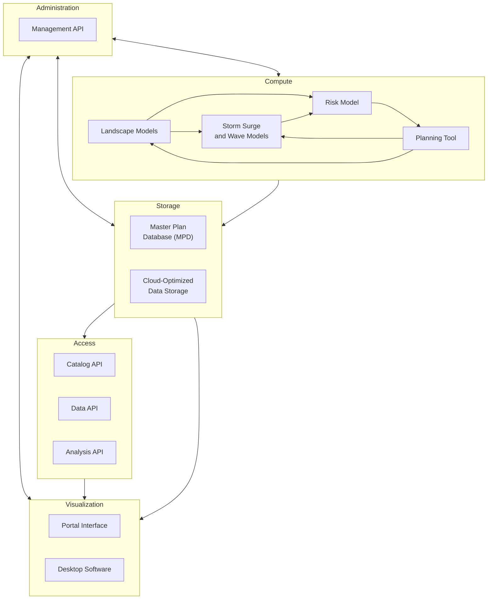
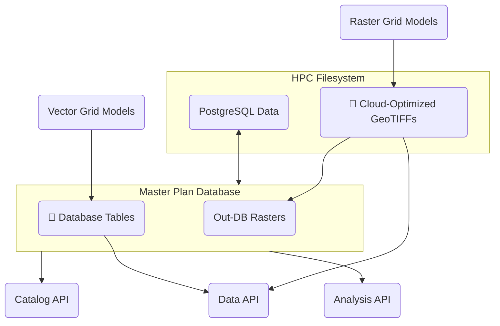
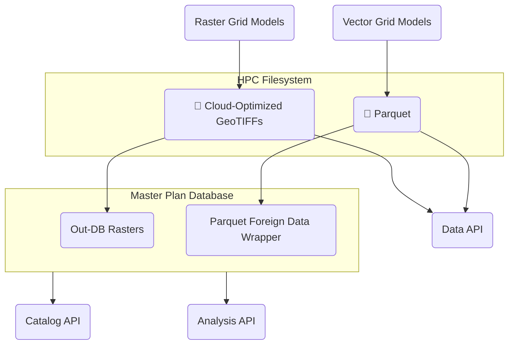
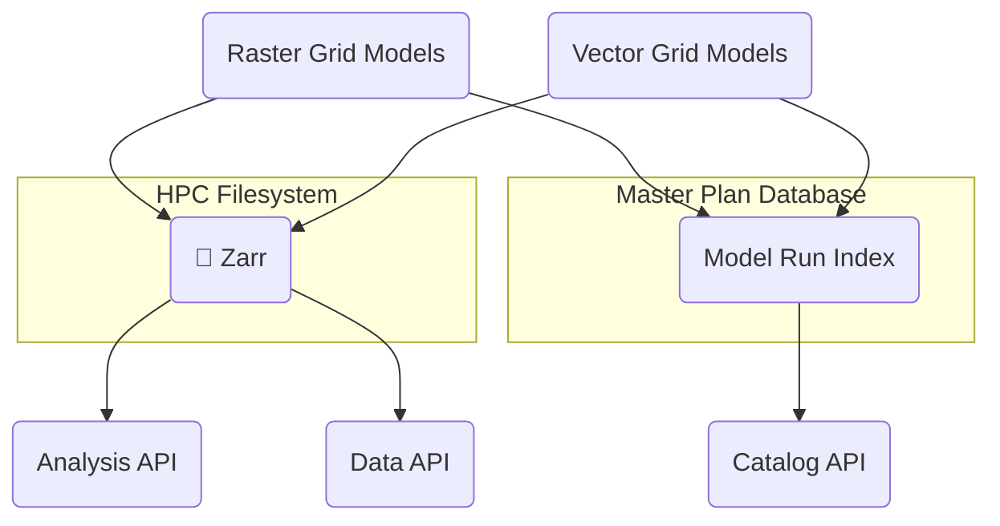
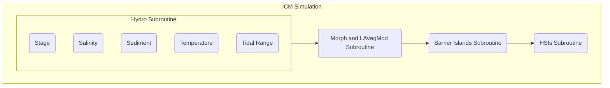

# Master Plan 2029 Technical Requirements

## Background

### Types of Master Plan Data

The master plan development process generates data of several types. These include:

- **Vector geometries** are used to represent model grids and project alignments.
- **Vector attributes** represent project attributes as well as grid cell values for model inputs and outputs.
- **Raster images** are used to represent some model inputs and outputs.

### Audience Groups

Data from the 2029 Master Plan will be used by a variety of stakeholders during and after the development of the plan. The table below summarizes these audience groups and their anticipated access patterns.

| | Plan Development Team | External Researchers | Elected Officials and Advisory Groups | Public and News Media |
|---|---|---|---|---|
| Audience Description | The plan development team includes CPRA staff and contractors responsible for data preparation, modeling, quality assurance, public engagement, and plan document preparation. | External researchers are scientists who are not involved in the development of the plan, but who use plan data as inputs to other coastal modeling and research studies. | Elected officials and advisory groups include state and local leaders responsible for guiding the development, approval, and implementation of the plan. | The public and news media audience includes residents, property owners, reporters, and any other non-technical stakeholders with an interest in the future of coastal Louisiana. |
| Objectives | Develop and communicate a fair, accurate, and scientifically-sound plan that maximizes environmental benefits to coastal Louisiana while minimizing risk and costs. | Use plan inputs and outputs to conduct additional research on the future of coastal Louisiana. | Shape a plan that responds to public input and that equitably balances cost and benefits. Communicate information about the plan and planning process to the public and other stakeholders. | Understand the benefits, costs, risks, and opportunities presented by the plan, and influence elected officials to make decisions that benefit the coast. |
| Data and Visualization Needs | Read and write raw data for modeling and project selection; visualize raw data for quality assurance; summarize and visualize raw data for reports and presentations. | Ingest raw data and metadata into external modeling processes; access summarized values for use as input parameters | Access summary data, visualizations, and project details, to understand the costs and benefits of projects and to communicate them to other stakeholders. | Access summary data, visualizations, and project summaries to understand the costs and benefits of projects |
| Data Access Software | Online portal; HPC platform and models; desktop GIS software; desktop analysis software | Online portal; external HPC platforms and models. | Online portal | Online portal |

## Goals

- Develop a unified and flexible data access and visualization software ecosystem.
- Store plan data in efficient formats that reflect anticipated access patterns and that minimize the need for data conversion and transfer.
- Provide APIs and data access methods that accommodate a wide variety of software running on HPC, cloud, and desktop platforms.
- Create integrated visualization and quality assurance tools that facilitate plan development and communication.
- Provide simulation management capabilities that facilitate coordination among members of the plan development team.

## Architecture Overview

The architecture of the master plan software is organized in five layers: administration, compute, storage, access, and visualization.

### Administration

The administration layer contains a **management API** that provides routes for managing users, teams, and simulation runs. It authenticates users and issues access tokens that are used to authorize access to the catalog API, data API, and analysis API.

### Compute

The compute layer contains the quantitative models used to analyze candidate projects. These models include **landscape models**, **storm surge and wave models**, and **risk model**, as well as the **planning tool** used optimize cost-benefit scenarios. While the details of these models are beyond the scope of this document, their interaction with the other layers of the architecture is a key consideration.

### Storage

The storage layer provides persistent data storage for project and model data. It consists of the **master plan database (MPD)**, which runs on a virtual machine in the HPC environment, and **cloud-optimized data storage** that lives on the HPC filesystem. Which datasets are stored in the MPD and which in the cloud-optimized files formats is a question that requires further investigation, as described below.

### Access

The access layer contains three APIs that provide information about, and access to, model data. The **catalog API** provides routes for querying which datasets and combinations of variables are available in the storage layer. It is indexed according to a hierarchy of variables to allow cascading selection of datasets.

The **data API** provides routes for accessing raw model data, while the **analysis API** provides routes for summarizing and comparing results across datasets. In both cases, the responses are provided in tabular and geospatial formats that can be consumed by the visualization layer.

### Visualization

The visualization layer provides tools for displaying and analyzing model data and projects. The **portal interface** is the primary component of this layer. It provides a web-based interface for mapping and charting data obtained via the access layer. It also provides an interface for quality assurance and approval functionality provided via the administration layer.

While most analysis and quality assurance tasks can be performed using the portal, some advanced techniques may require the use of **desktop software**, such as ArcGIS or QGIS. The data formats provided by the access layer are designed to be compatible with common desktop analysis tools, minimizing the need to move or convert data.

## Model Data Storage

In the 2023 master plan, model data were stored on the HPC filesystem. Attributes for vector model grids were stored as CSVs, and raster outputs were stored in a variety of image formats, including binary dumps, ASCII gridded XYZ files, and GeoTIFFs. Some of the attribute data from the CSVs were later imported into the project development database (PDD) and exposed via a time series API for use in the Data Access Portal (DAP). Some of the raster outputs were converted to Cloud Optimized GeoTIFFs (COGs) and map tiles (MBTiles) for download and display, respectively, in the DAP.

**2023 Model Data Storage Summary**

| Model Grid Type | Model Output Format | Intermediate Formats | Download and Display Formats |
|---|---|---|---|
| Vector | CSV | PostgreSQL table | CSV, JSON (generated by the time series API in real time)
| Raster | Binary dump | ASCII gridded XYZ, GeoTIFF | COG, MBTiles

The 2023 data storage approach had several limitations that the 2029 plan aims to improve:

- Raw model data, such as CSVs and raster binary dumps, had to be explicitly converted into display formats using postprocessing scripts. As a result, results were not immediately viewable after a model run completed.

- Use of uncompressed file formats for model outputs increased file read and write times and filesystem usage.

- Storage of each dataset in multiple formats increased filesystem usage.

- Adding model data to the PDD required moving the database storage to a network filesystem (Ocean), degrading the database performance.

- The lack of a centralized model data store required building a separate data catalog that had to be updated manually when new runs were added.

In addition to addressing these limitations, any data storage approach considered for the 2029 plan needs to scale well beyond the volume of data produced by the 2023 plan. The planned change in spatial resolution for the risk model from communities to grid cells will dramatically increase the volume of data produced by that model, and changes in other models could have similar impacts. As a result, testing each of the candidate storage approaches at scale will be a key aspect of its evaluation.

In the following sections, three possible approaches to model data storage in the 2029 plan are presented for comparison. Their impacts on other components in the software architecture are identified, as are performance and scalability testing considerations.

### Database-Centric Storage

This approach modifies the 2023 data storage flow by eliminating the raw output and intermediate formats for model data. Data for vector model grids are saved directly to database tables by the models. Data for raster model grids are saved on the HPC filesystem as COGs and indexed in the database as out-of-database (out-DB) rasters.

### Hybrid Database-Cloud Storage

This approach is similar to the database-centric approach, but instead of storing data for vector grid models in the MPD, these data are saved on the HPC filesystem in the [Apache Parquet](https://parquet.apache.org/) format. Parquet is a modern tabular data format that supports compression, indexing, and random access, giving it some of the same advantages of database storage. At the same time, Parquet data are stored as regular files, making them as easy to read, write, manage, and back up as CSVs. In addition, Parquet files can be exposed in a PostgreSQL database using the [Parquet foreign data wrapper](https://github.com/adjust/parquet_fdw/), allowing their data to be used in database queries and views.

### Cloud-Native Storage

In this approach, data for vector and raster model grids are stored in Zarr, a cloud-native file format for large, multi-dimensional arrays. Like Parquet, Zarr supports compression, indexing, and random access. However, unlike Parquet, which stores data as a single file, Zarr data are stored in series of small chunk files, improving read performance while making the administration of the data on the filesystem more complex.

In the cloud-native approach, model data are not directly accessible from within the MPD. However, the MPD stores references to each model run, allowing it to serve as an index for the model data.

### Comparison

| | Database-Centric Storage | Hybrid Database-Cloud Storage | Cloud-Native Storage |
|---|---|---|---|
| File compression | None | Customizable per-column | Customizable per-array |
| Filesystem limitations | Database performance limited by HPC filesystem | None | Chunk size limited by HPC filesystem inode quotas |
| Data access: vector grid models | PostgreSQL, APIs | PostgreSQL, Parquet, APIs | Zarr, APIs |
| Data access: raster grid models | PostgreSQL, COG, APIs | PostgreSQL, COG, APIs | Zarr, APIs |

## QA/QC (Quality Assurance/Quality Control)

In the 2023 Master Plan, the [QA/QC portal](https://mp2023.bridges2.psc.edu/) was created to provide support to the team in their review and analysis of simulation runs. This portal was built with the intention of supplanting the Google Sheet review process by offering one source to track all comments, approvals, and issues related to model runs. This portal also attempted to incorporate business logic that was formalized around the Google Sheet review process.
The existing QA/QC portal had several limitations that we hope to address in this next phase of development:
- Too strict
    - The business logic that was decided upon was too strict when translated into the web portal format. Because results were displayed sequentially (based on the business logic previously described), users from teams that were part of "later" portions of the workflow were unable to review their data. This also meant that users from teams that were part of the "earlier" portions of the workflow were unable to review data from teams that were part of those "later" portions. Eventually, this system was relaxed so that users could view any data in the system.
- Navigation
    - By incorporating the aforementioned business logic, the navigational layout of the system was extremely cumbersome. Rather than users being able to quickly find the data they were looking for, they would have to wade through multiple layers of data before arriving at their desired view.

### QA/QC 2023 Business Logic

For each of the "Subroutines" in the figure above, there were a variety of "Validation Items." Every Validation Item for a given Subroutine **had to be approved** before the next subroutine would be made available for review.

### QA/QC for 2029

It is because of the issues that appeared due to the strictness of the integration of this business logic into the portal that we are strongly advocating for a more relaxed approach towards business logic definitions. We envision that this next phase of QA/QC will be guided by the need for policy flexibility and for business logic that is enabled by the software, but enforced by human intervention. Rather than an **explicit** QA/QC process, we propose an **implicit** QA/QC process.

In the **explicit** process, team members were required to approve individual metrics, validation items, and subroutines. Only then could an administrator approve the overarching simulation run. In the proposed **implicit** process, team members are no longer required to approve each individual step prior to administrator approval of the run. Rather, the administrator's simulation run approval will be guided by the existence (or lack) of comments and issues (open or resolved).

#### Comments

Comments will be the driving force behind this implicit QA/QC process. As such, the comment system will require additional features that will allow administrators to determine whether they can approve a particular simulation run. Some of those key features include, but are not limited to:

- Categorization
    - We must offer the ability for team members to classify their comment as an issue, a narrative comment, or other (currently undefined) types.
- Replies/discussions
    - We must offer the ability for comments to build on other comments. Namely, it must be possible for a comment to be associated with another comment so that the relationships between these comments can be captured.
- Issue resolution
    - When a user categorizes a comment as an issue, there must be a mechanism by which that issue is resolved. There must also be a mechanism by which team members can view "unresolved" issues.

#### Simulation Run Tracker

As we shift towards an implicit approval approach, we must create visualizations, reports, and metrics that administrators can use to determine whether a particular simulation run can be marked as "approved." We propose that these tools and metrics live within the context of a "Simulation Run Tracker." This view will allow administrators to monitor the progress of their simulation runs, review project details, and perform their approval analysis. Some of these tools and metrics include:

- Comment count metrics
- Overview of unresolved issues
- Overview of resolved issues (how they were resolved)
- Last touched date (last time a comment or issue was made)
- KPIs (such as percent complete)
- Simulation Run status (In Progress, Error, Under Review, Approved)

As described previously, part of the **implicit** QA/QC process requires that the business logic surrounding a simulation run's approval be enforced by humans rather than by the software. For example, if the team decides that a simulation run should never be approved if there are **any** unresolved issues, the administrator must ensure that this is the case prior to approving a simulation run. By not building this business logic (preconditions for approval) into the portal, we will avoid having to adjust code or business logic once the portal is live. We believe that if logic shifts over time, this flexibility allows the team to avoid bottlenecks that would require developer intervention.

Despite the best of intentions, it is always possible for a human-enforced system to fail. That is, something that should not be approved is approved (or vice versa). Because of this, the development team is planning to explore two approaches for codifying basic business logic in a more flexible manner, such that some basic checks and balances can be integrated into the user experience, to minimize the chances of human failure.

#### External Project Management System

By relying on an existing project management system as the back-end for business logic, non-technical users can affect or modify the ways in which the system allows for approvals. This requires some thorough investigation (and must be weighed against any potential costs as well). If this option is selected, we envision that the project management tool would be mostly transparent to the portal's users. That is, from the portal side, users would not have to open up this external system. Only those who wish to modify the business logic would open this external system (or if they find the reports in the external system to be useful).

#### Custom Business Logic

Although we argue against this, we recognize that if the external project management system approach does not meet the team's needs, there will be a need to develop this error catching logic into the portal directly.

## Analysis Capabilities
As described previously, the team is planning on offering an Analysis API which will be used to drive some of the front-end UI visualizations and charts. However, there are still open questions surrounding how this API will be built/generate analysis.

### Pre-compute vs Live Analysis
There is an understanding that the team does rely on several common sets of analysis. With this in mind, it is important to consider whether these sets should be pre-computed and stored in the MPD directly, or whether the Analysis API should always perform this analysis live. More investigation is necessary to determine the appropriate approach here. It is clear that the main factors to consider here are the speed at which the Analysis API is able to gather information live and then perform analysis - versus how much additional storage is necessary to store these pre-computed analysis datasets. 

### Analysis Features
Some analysis features include but are not limited to:

- Comparisons between different geographies using the same metric.
- Comparisons between the same geographies at different time deltas.
- Comparisons between the same geographies in different simulation runs (FWOA vs FWA).

These comparisons can and should operate on both tabular and raster data.

### Additional Considerations
- The approach here is highly dependent on the method chosen for [Data Storage](#data-storage).
- For raster data, there may be a need to have dynamic color ramps (or the ability to pass color ramps).
