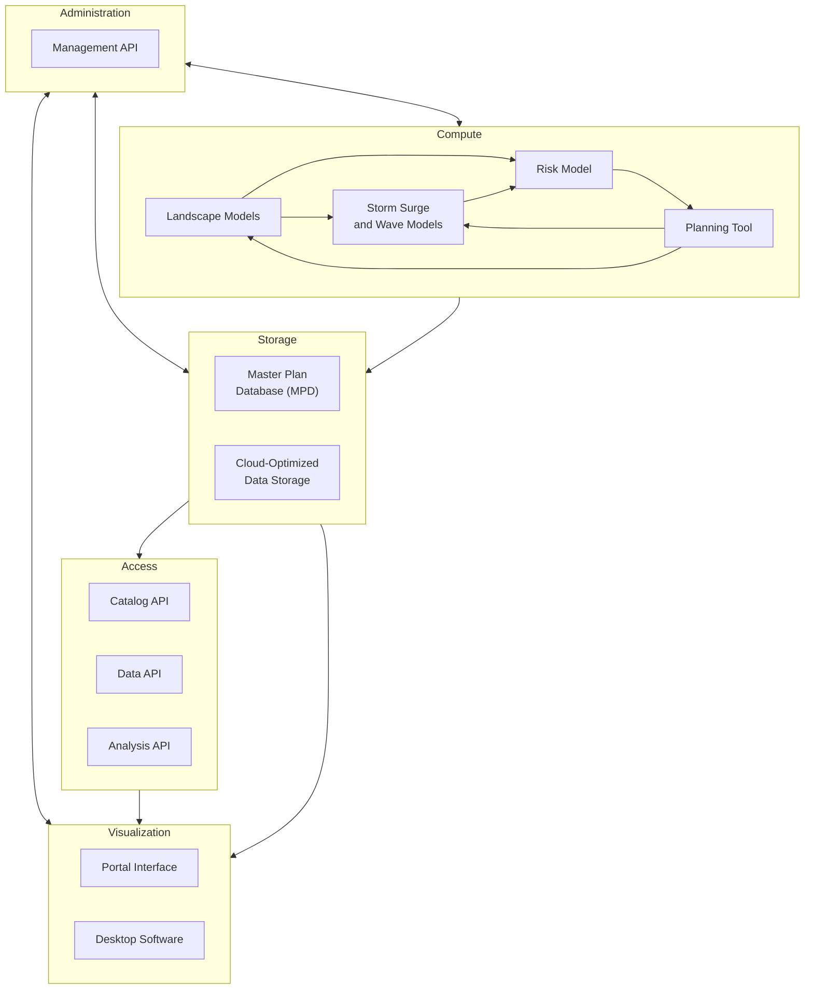

# Master Plan 2029 Technical Requirements

## Background

### Types of Master Plan Data

The master plan development process generates data of several types. These include:

- **Vector geometries** are used to represent model grids and project alignments.
- **Vector attributes** represent project attributes as well as grid cell values for model inputs and outputs.
- **Raster images** are used to represent some model inputs and outputs.

### Audience Groups

Data from the 2029 Master Plan will be used by a variety of stakeholders during and after the development of the plan. The table below summarizes these audience groups and their anticipated access patterns.

| | Plan Development Team | External Researchers | Elected Officials and Advisory Groups | Public and News Media |
|---|---|---|---|---|
| Audience Description | The plan development team includes CPRA staff and contractors responsible for data preparation, modeling, quality assurance, public engagement, and plan document preparation. | External researchers are scientists who are not involved in the development of the plan, but who use plan data as inputs to other coastal modeling and research studies. | Elected officials and advisory groups include state and local leaders responsible for guiding the development, approval, and implementation of the plan. | The public and news media audience includes residents, property owners, reporters, and any other non-technical stakeholders with an interest in the future of coastal Louisiana. |
| Objectives | Develop and communicate a fair, accurate, and scientifically-sound plan that maximizes environmental benefits to coastal Louisiana while minimizing risk and costs. | Use plan inputs and outputs to conduct additional research on the future of coastal Louisiana. | Shape a plan that responds to public input and that equitably balances cost and benefits. Communicate information about the plan and planning process to the public and other stakeholders. | Understand the benefits, costs, risks, and opportunities presented by the plan, and influence elected officials to make decisions that benefit the coast. |
| Data and Visualization Needs | Read and write raw data for modeling and project selection; visualize raw data for quality assurance; summarize and visualize raw data for reports and presentations. | Ingest raw data and metadata into external modeling processes; access summarized values for use as input parameters | Access summary data, visualizations, and project details, to understand the costs and benefits of projects and to communicate them to other stakeholders. | Access summary data, visualizations, and project summaries to understand the costs and benefits of projects |
| Data Access Software | Online portal; HPC platform and models; desktop GIS software; desktop analysis software | Online portal; external HPC platforms and models. | Online portal | Online portal |

## Goals

- Develop a unified and flexible data access and visualization software ecosystem.
- Store plan data in efficient formats that reflect anticipated access patterns and that minimize the need for data conversion and transfer.
- Provide APIs and data access methods that accommodate a wide variety of software running on HPC, cloud, and desktop platforms.
- Create integrated visualization and quality assurance tools that facilitate plan development and communication.
- Provide simulation management capabilities that facilitate coordination among members of the plan development team.

## Architecture Overview

The architecture of the master plan software is organized in five layers: administration, compute, storage, access, and visualization.

### Administration

The administration layer contains a **management API** that provides routes for managing users, teams, and simulation runs. It authenticates users and issues access tokens that are used to authorize access to the catalog API, data API, and analysis API.

### Compute

The compute layer contains the quantitative models used to analyze candidate projects. These models include **landscape models**, **storm surge and wave models**, and **risk model**, as well as the **planning tool** used optimize cost-benefit scenarios. While the details of these models are beyond the scope of this document, their interaction with the other layers of the architecture is a key consideration.

### Storage

The storage layer provides persistent data storage for project and model data. It consists of the **master plan database (MPD)**, which runs on a virtual machine in the HPC environment, and **cloud-optimized data storage** that lives on the HPC filesystem. Which datasets are stored in the MPD and which in the cloud-optimized files formats is a question that requires further investigation, as described below.

### Access

The access layer contains three APIs that provide information about, and access to, model data. The **catalog API** provides routes for querying which datasets and combinations of variables are available in the storage layer. It is indexed according to a hierarchy of variables to allow cascading selection of datasets.

The **data API** provides routes for accessing raw model data, while the **analysis API** provides routes for summarizing and comparing results across datasets. In both cases, the responses are provided in tabular and geospatial formats that can be consumed by the visualization layer.

### Visualization

The visualization layer provides tools for displaying and analyzing model data and projects. The **portal interface** is the primary component of this layer. It provides a web-based interface for mapping and charting data obtained via the access layer. It also provides an interface for quality assurance and approval functionality provided via the administration layer.

While most analysis and quality assurance tasks can be performed using the portal, some advanced techniques may require the use of **desktop software**, such as ArcGIS or QGIS. The data formats provided by the access layer are designed to be compatible with common desktop analysis tools, minimizing the need to move or convert data.