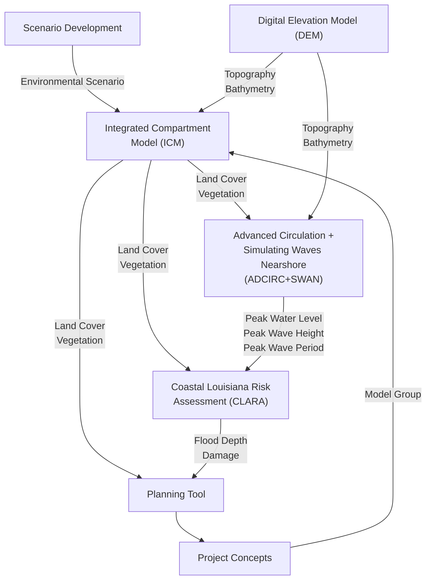
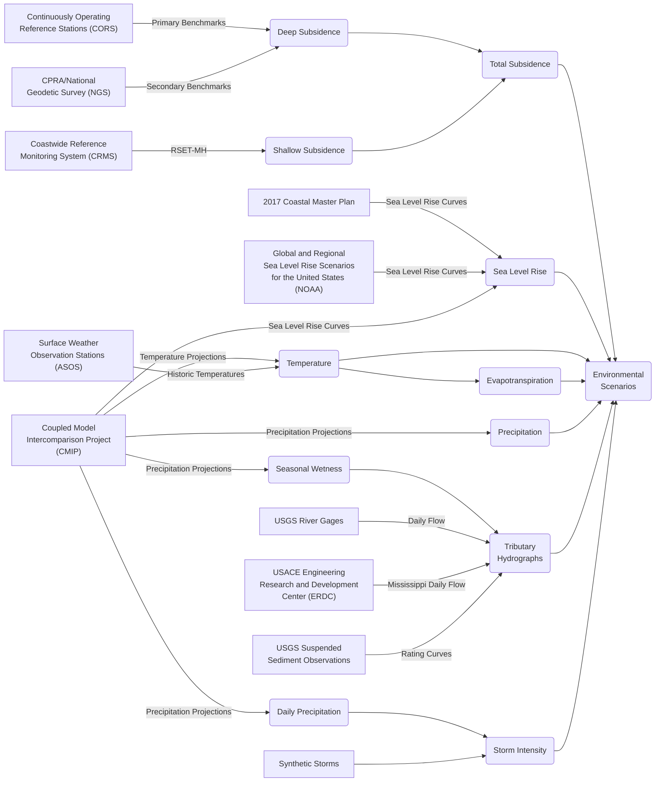

# CPRA Master Plan Documentation

## Models Overview

## Scenario Development

## Digital Elevation Model

## Integrated Compartment Model (ICM)

## Advanced Circulation + Simulating Waves Nearshore (ADCIRC+SWAN)

## Coastal Louisiana Risk Assessment (CLARA)

## Planning Tool