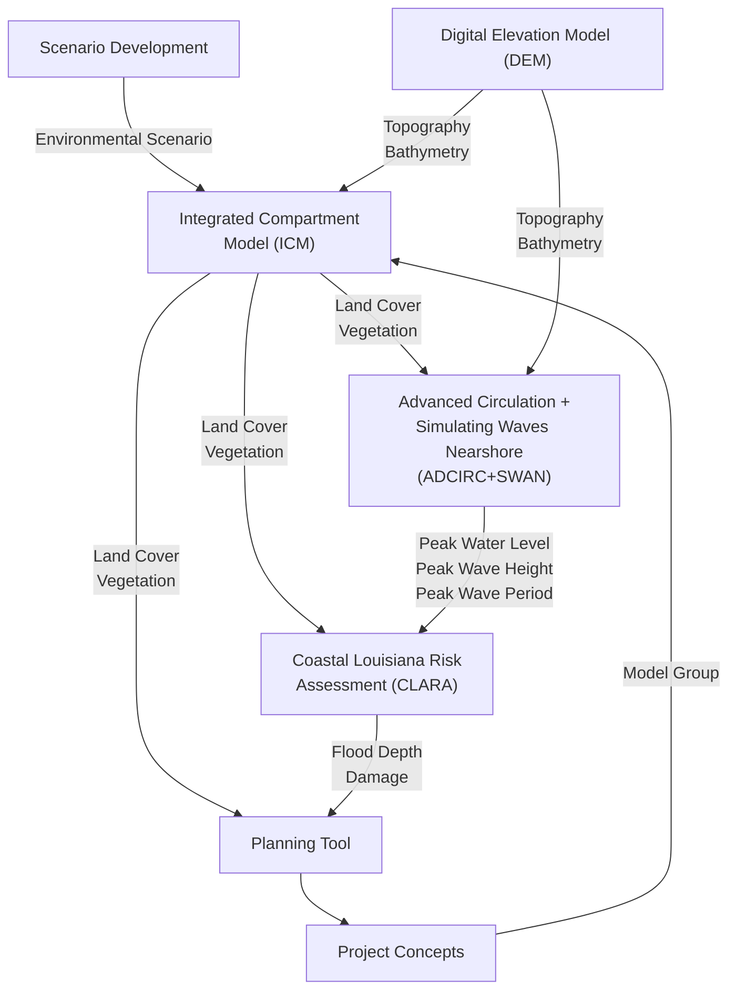
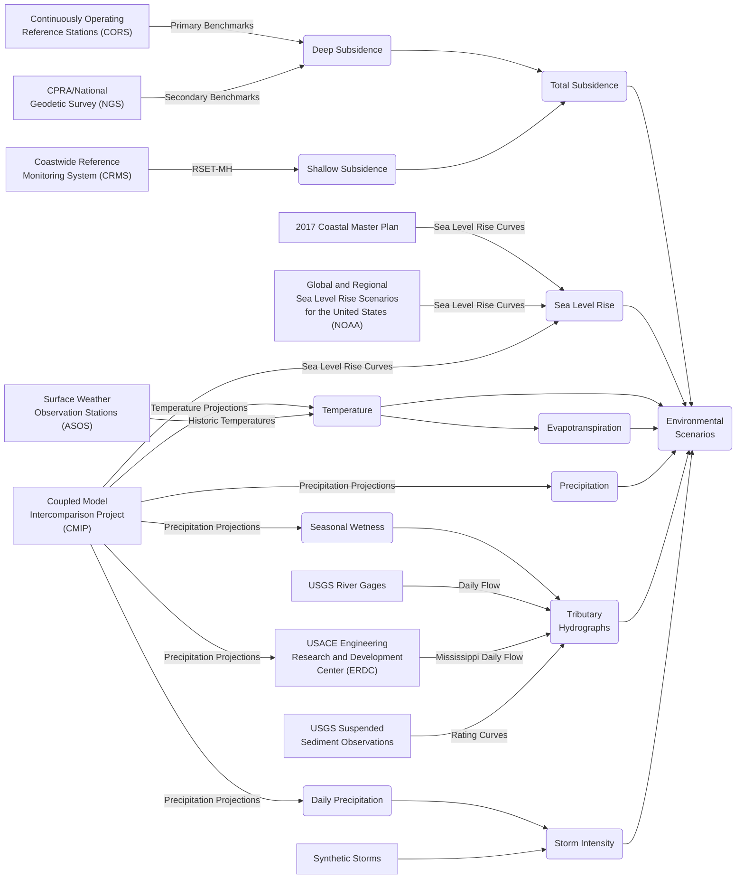
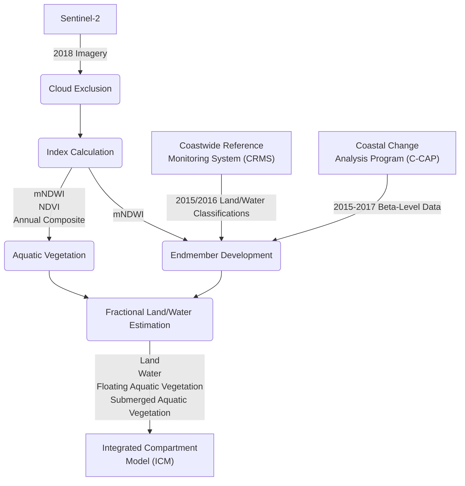
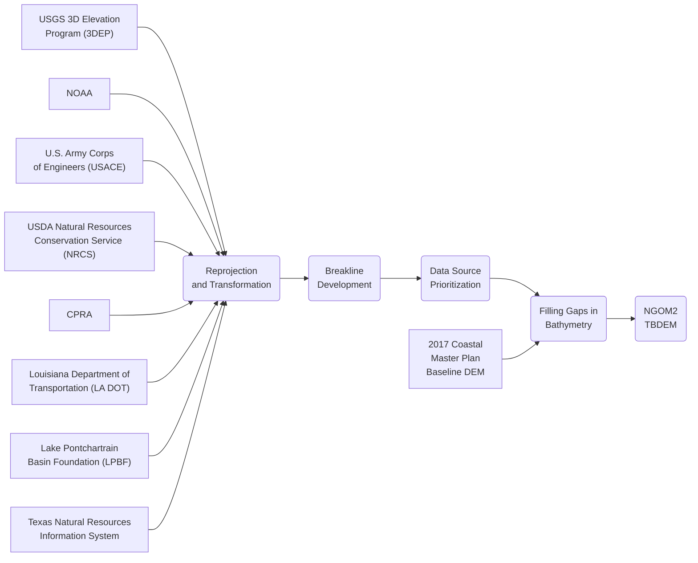
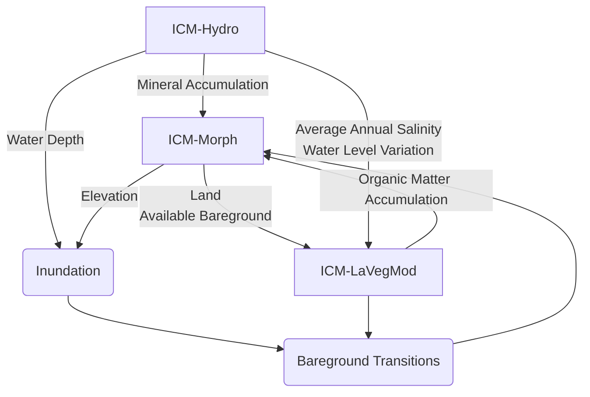
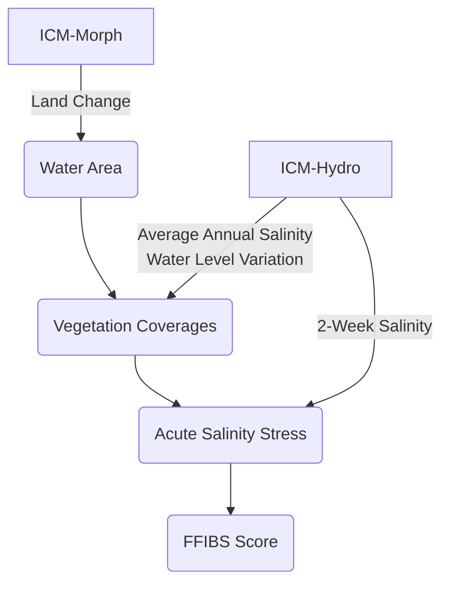
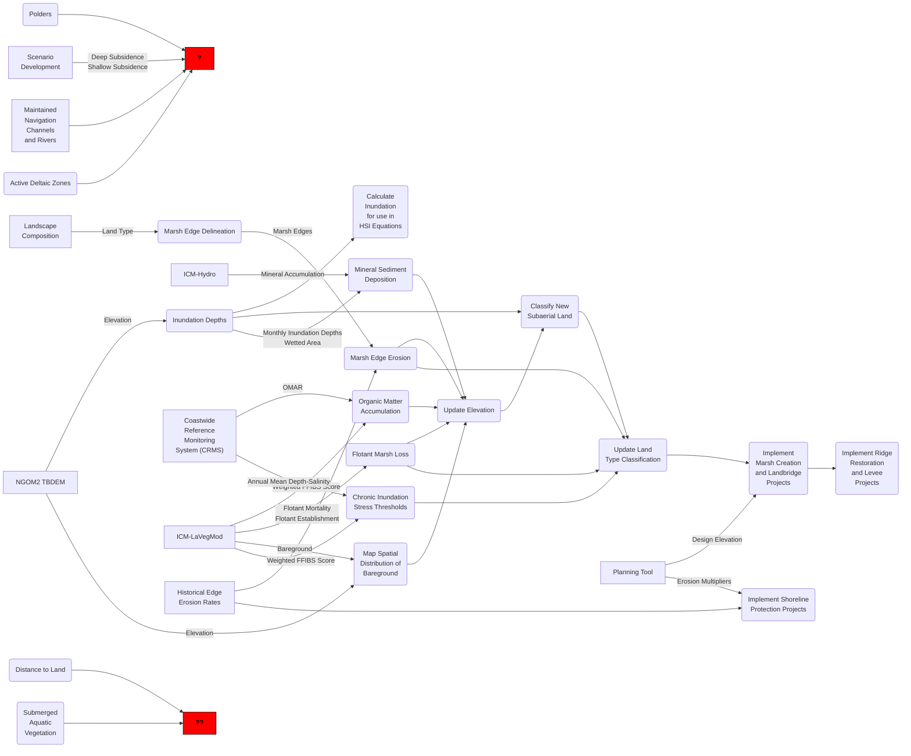
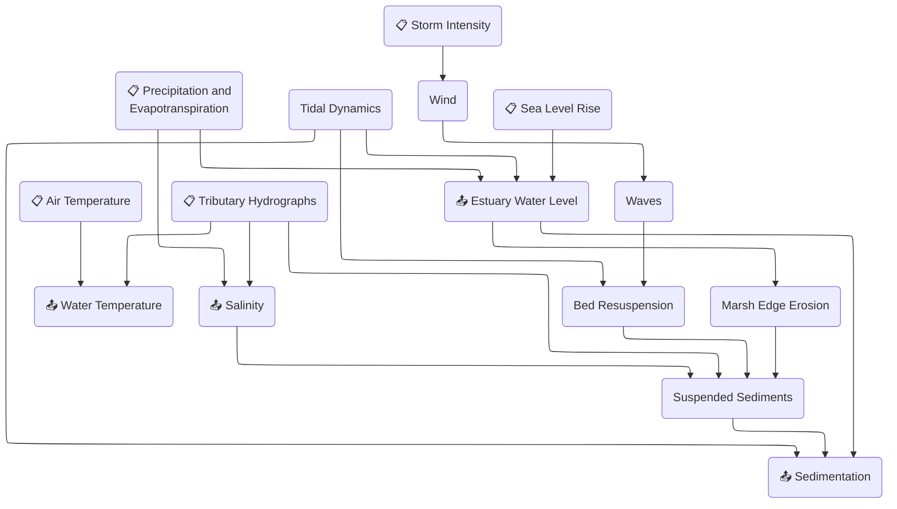

# CPRA Master Plan Documentation

## Models Overview

## 📋 Scenario Development

## 🌏 Landscape Composition

## 📐 Digital Elevation Model (DEM)

## 📦 Integrated Compartment Model (ICM)

_Data Source: [2023 Master Plan Attachment C8][C8]_

### 🌱 ICM-LAVegMod

_Data Source: [Attachment C8][C8]_

### 🌄 ICM-Morph

_Data Source: [2023 Master Plan Attachment C8][C8]_

ICM-Morph includes a preprocessing subroutine that reads data into memory. It is omitted from the diagram for readability.

### 💧 ICM-Hydro

_Data Source: [2017 Coastal Master Plan Attachment C3-22][C3-22]_

## 🌀 Advanced Circulation + Simulating Waves Nearshore (ADCIRC+SWAN)

## 💵 Coastal Louisiana Risk Assessment (CLARA)

## 💻 Planning Tool

[C8]: https://coastal.la.gov/wp-content/uploads/2024/02/C8_ICM-LAVegModICM-Morph_v2.pdf

[C3-22]: http://coastal.la.gov/wp-content/uploads/2017/04/Attachment-C3-22_FINAL_03.07.2017.pdf
