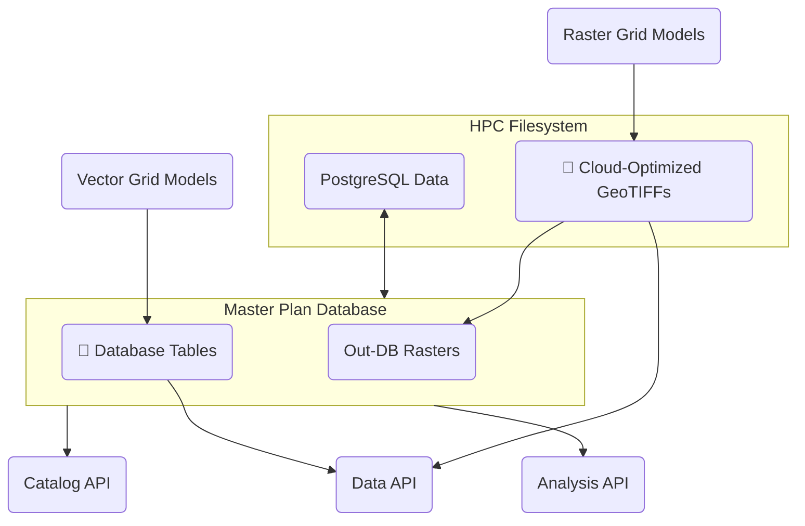
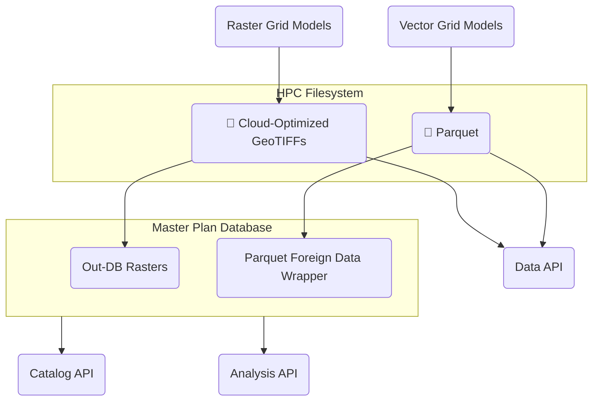
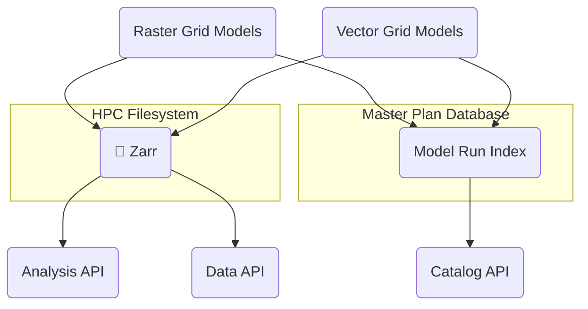

# 2029 Coastal Master Plan Model Data Storage Testing

In the following sections, three possible approaches to model data storage in the 2029 plan are presented for comparison. Their impacts on other components in the software architecture are identified, as are performance and scalability testing considerations.

### Database-Centric Storage

This approach modifies the 2023 data storage flow by eliminating the raw output and intermediate formats for model data. Data for vector model grids are saved directly to database tables by the models. Data for raster model grids are saved on the HPC filesystem as COGs and indexed in the database as out-of-database (out-DB) rasters.

### Hybrid Database-Cloud Storage

This approach is similar to the database-centric approach, but instead of storing data for vector grid models in the MPD, these data are saved on the HPC filesystem in the [Apache Parquet](https://parquet.apache.org/) format. Parquet is a modern tabular data format that supports compression, indexing, and random access, giving it some of the same advantages of database storage. At the same time, Parquet data are stored as regular files, making them as easy to read, write, manage, and back up as CSVs. In addition, Parquet files can be exposed in a PostgreSQL database using the [Parquet foreign data wrapper](https://github.com/adjust/parquet_fdw/), allowing their data to be used in database queries and views.

### Cloud-Native Storage

In this approach, data for vector and raster model grids are stored in Zarr, a cloud-native file format for large, multi-dimensional arrays. Like Parquet, Zarr supports compression, indexing, and random access. However, unlike Parquet, which stores data as a single file, Zarr data are stored in series of small chunk files, improving read performance while making the administration of the data on the filesystem more complex.

In the cloud-native approach, model data are not directly accessible from within the MPD. However, the MPD stores references to each model run, allowing it to serve as an index for the model data.

### Comparison

| | Database-Centric Storage | Hybrid Database-Cloud Storage | Cloud-Native Storage |
|---|---|---|---|
| File compression | None | Customizable per-column | Customizable per-array |
| Filesystem limitations | Database performance limited by HPC filesystem | None | Chunk size limited by HPC filesystem inode quotas |
| Data access: vector grid models | PostgreSQL, APIs | PostgreSQL, Parquet, APIs | Zarr, APIs |
| Data access: raster grid models | PostgreSQL, COG, APIs | PostgreSQL, COG, APIs | Zarr, APIs |

### Performance Testing

We tested both the in-database storage and the Parquet storage options for performance. The Zarr storage option was not fully tested since its file storage scheme (many small chunk files in nested directories) is not a good match for the Ocean Lustre filesystem and since the software that can read it is more limited than Parquet.

For Parquet storage, we tested both "wide" and "long" formats, as well as a variety of compression algorithms and levels. The wide format is the data shape used by ICM, in which each day is a row, and each geography is a column. The long format is the data shape used in the MPD, in which the geography columns are "melted" to form a single geography column with a corresponding value column.

The tests were run using hydro compartment-level daily salinity data for the full 2023 plan period. The primary queries tested were:

* **Portal map query:** 1 scenario, 1 model group, 1 date, all hydro compartments
* **Portal chart query:** 1 scenario, 1 model group, all dates, 1 hydro compartment
* **Model query:** 1 scenario, 1 model group, all dates, all hydro compartments

| Metric | In-Database | Parquet Long | Parquet Wide |
|---|---|---|---|
| Portal map query performance (VM) | ~ 1,700 ms | < 100 ms | ~ 500 ms ⚡ |
| Portal chart query performance (VM) | ~ 800 ms | ~ 1,900 ms 📅 | < 100 ms |
| Model query performance (2 cores RM-shared) | ? | ~ 1,000 ms 📅 | ~ 500 ms ⚡ |
| PostgreSQL query performance | N/A | ~ 10 s / 1 M rows (via `parquet_fdw`) | ~ 120 s / 1 M rows (melted to long format via `plpython3u`) |
| Performance impact as data size increases | Unknown | Minimal (with appropriate partitioning scheme) | Minimal (with appropriate partitioning scheme) |
| Compression ratio (Zstd level 6, relative to CSV) | N/A | ~ 1.4x | ~ 2.4x |
| Catalog storage | External storage (TBD) | Partition directories | Partition directories |
| Backup complexity | Complex (periodic full backups + WAL) | Simple (via `rsync`) | Simple (via `rsync`) |

⚡ _This query time could probably be reduced by using additional cores._ \
📅 _This query time could probably be reduced by partitioning the Parquet files by year._

### Parquet Compression and Row Group Size

We tested a variety of compression algorithms (`brotli`, `gzip`, `lz4`, and `zstd`) at a variety of compression levels and row group sizes. `lz4` had the fastest compression and decompression speeds but the lowest compression ratio, while `brotli` achieved the best compression, but with significantly slower decompression. Overall, `zstd` had the best balance of performance and compression, with decompression speeds slightly slower than `lz4` and file sizes slightly larger than `brotli`. We recommend using the `zstd` algorithm at compression level 6. Beyond compression level 6, file sizes decreased only slightly, while compression times increased significantly.

We tested row group sizes of 100,000, 500,000, and 1,000,000 for the long-format Parquet files, and 1,000, 5,000, and 10,000 for the wide-format files. For both data shapes, the middle row group size (500,000 and 5,000, respectively) had the best balance of file size and performance.