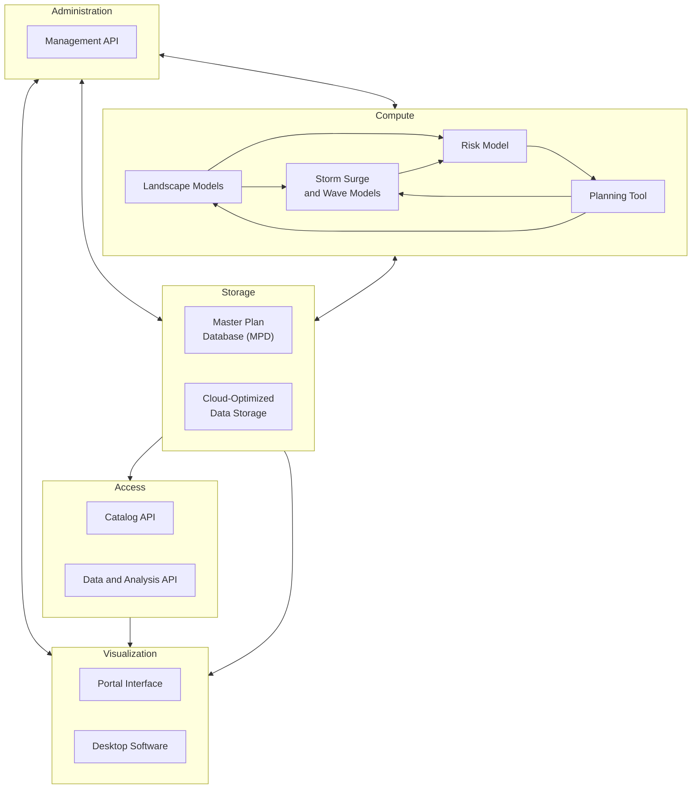
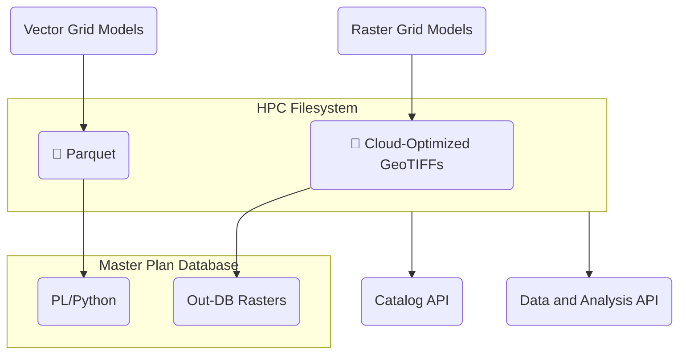
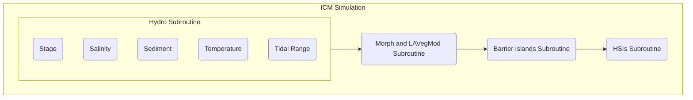
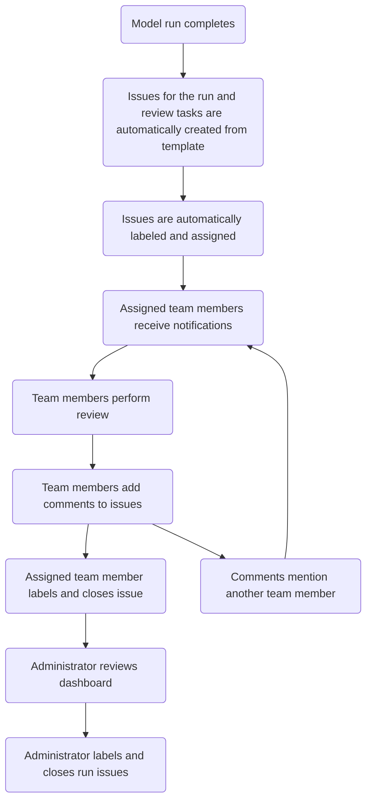

# 2029 Coastal Master Plan Technical Requirements

## Background

### Types of Master Plan Data

The master plan development process generates data of several types. These include:

- **Vector geometries** are used to represent model grids and project alignments.
- **Vector attributes** represent project attributes as well as grid cell values for model inputs and outputs.
- **Raster images** are used to represent some model inputs and outputs.

### Audience Groups

Data from the 2029 Master Plan will be used by a variety of stakeholders during and after the development of the plan:

- **Modeling Teams:** The modeling teams include CPRA staff and contractors responsible for data preparation, modeling, and quality assurance.
- **Strategy Team:** The strategy teams includes CPRA staff who provide direction to the planning process and oversee modeling, public engagement, and plan document preparation.
- **Advisory Groups:** Advisory groups include external stakeholders who provide input and guide the planning process.
- **External Researchers:** External researchers are scientists who are not involved in the development of the plan, but who use plan data as inputs to other coastal modeling and research studies. 
- **Elected Officials:** Elected officials include state and local leaders responsible for the implementation of plan projects.
- **Public an News Media:** The public and news media audience includes residents, property owners, reporters, and any other non-technical stakeholders with an interest in the future of coastal Louisiana.

These audiences will interact with plan data and visualizations in different ways:

| | Modeling Teams | Strategy Team | Advisory Groups | External Researchers | Elected Officials | Public and News Media |
|---|---|---|---|---|---|---|
| Write data | ✅ | ❌ | ❌ | ❌ | ❌ | ❌ | ❌| ❌ |
| Perform quality assurance on data | ✅ | ❌ | ❌ | ❌ | ❌ | ❌ | ❌| ❌ |
| Download data | ✅ | ❌ | ❌ | ✅ | ❌ | ❌ |
| Visualize data in an online portal | ✅ | ✅ | ✅ | ✅ | ✅ | ✅ |
| Visualize data in desktop software | ✅ | ✅ | ❌ | ✅ | ❌ | ❌ |
| Access project fact sheets | ✅ | ✅ | ✅ | ✅ | ✅ | ✅ |

## Goals

- Develop a unified and flexible data access and visualization software ecosystem.
- Store plan data in efficient formats that reflect anticipated access patterns and that minimize the need for data conversion and transfer.
- Provide APIs and data access methods that accommodate a wide variety of software running on HPC, cloud, and desktop platforms.
- Create integrated visualization and quality assurance tools that facilitate plan development and communication.
- Provide simulation management capabilities that facilitate coordination among members of the plan development team.

## Architecture Overview

The architecture of the master plan software is organized in five layers: administration, compute, storage, access, and visualization.



### Administration

The administration layer contains a **management API** that provides routes for managing users, teams, and simulation runs. It authenticates users and issues access tokens that are used to authorize access to the catalog API and the data and analysis API.

### Compute

The compute layer contains the quantitative models used to analyze candidate projects. These models include **landscape models**, **storm surge and wave models**, and **risk model**, as well as the **planning tool** used optimize cost-benefit scenarios. While the details of these models are beyond the scope of this document, their interaction with the other layers of the architecture is a key consideration.

### Storage

The storage layer provides persistent data storage for project and model data. It consists of the **master plan database (MPD)**, which runs on a virtual machine in the HPC environment, and **cloud-optimized data storage** that lives on the HPC filesystem. Which datasets are stored in the MPD and which in the cloud-optimized files formats is a question that requires further investigation, as described below.

### Access

The access layer contains three APIs that provide information about, and access to, model data. The **catalog API** provides routes for querying which datasets and combinations of variables are available in the storage layer. It is indexed according to a hierarchy of variables to allow cascading selection of datasets.

The **data and analysis API** provides routes for accessing, summarizing, and comparing model data. The responses are provided in tabular and geospatial formats that can be consumed by the visualization layer.

### Visualization

The visualization layer provides tools for displaying and analyzing model data and projects. The **portal interface** is the primary component of this layer. It provides a web-based interface for mapping and charting data obtained via the access layer. It also provides an interface for quality assurance and approval functionality provided via the administration layer.

While most analysis and quality assurance tasks can be performed using the portal, some advanced techniques may require the use of **desktop software**, such as ArcGIS or QGIS. The data formats provided by the access layer are designed to be compatible with common desktop analysis tools, minimizing the need to move or convert data.

## Model Data Storage

In the 2023 master plan, model data were stored on the HPC filesystem. Attributes for vector model grids were stored as CSVs, and raster outputs were stored in a variety of image formats, including binary dumps, ASCII gridded XYZ files, and GeoTIFFs. Some of the attribute data from the CSVs were later imported into the project development database (PDD) and exposed via a time series API for use in the Data Access Portal (DAP). Some of the raster outputs were converted to Cloud Optimized GeoTIFFs (COGs) and map tiles (MBTiles) for download and display, respectively, in the DAP.

**2023 Model Data Storage Summary**

| Model Grid Type | Model Output Format | Intermediate Formats | Download and Display Formats |
|---|---|---|---|
| Vector | CSV | PostgreSQL table | CSV, JSON (generated by the time series API in real time)
| Raster | Binary dump | ASCII gridded XYZ, GeoTIFF | COG, MBTiles

The 2023 data storage approach had several limitations that the 2029 plan aims to improve:

- Raw model data, such as CSVs and raster binary dumps, had to be explicitly converted into display formats using postprocessing scripts. As a result, results were not immediately viewable after a model run completed.

- Use of uncompressed file formats for model outputs increased file read and write times and filesystem usage.

- Storage of each dataset in multiple formats increased filesystem usage.

- Adding model data to the PDD required moving the database storage to a network filesystem (Ocean), degrading the database performance.

- The lack of a centralized model data store required building a separate data catalog that had to be updated manually when new runs were added.

In addition to addressing these limitations, any data storage approach considered for the 2029 plan needs to scale well beyond the volume of data produced by the 2023 plan. The planned change in spatial resolution for the risk model from communities to grid cells will dramatically increase the volume of data produced by that model, and changes in other models could have similar impacts. As a result, testing each of the candidate storage approaches at scale will be a key aspect of its evaluation.

### 2029 Model Data Storage Approaches

To address the limitations in the 2023 model data storage system, we [evaluated three approaches for 2029 model data storage](model_data_storage.md):

- [Database-Centric Storage](model_data_storage.md#database-centric-storage)
- [Hybrid Database-Cloud Storage](model_data_storage.md#hybrid-database-cloud-storage)
- [Cloud-Native Storage](model_data_storage.md#cloud-native-storage)

### Proposed Data Storage Approach

Based on the test results, we recommend implementing a modified version of the hybrid database-cloud storage option using COGs and Parquet files in the wide format. Using `zstd` compression at level 6 for both the COG and Parquet files—as well as a row group size of 5,000 for the Parquet files—optimizes file size and query performance in most cases. The main drawback of this option is that accessing the Parquet files via the database is slow due to the use of Python to read and transpose the Parquet files in real time.



#### Data Structure

The proposed data structure—including variables, dimensions, and data types—is described in the [documentation for the cpra.mp.data Python library](https://github.com/pscedu/cpra.mp.data). This repository also includes examples of reading and writing model data in Python.

#### Data Archival and Replacement

In addition to the main data directory that contains active data, there is a second, parallel directory that follows the same dimension hierarchy and is used for archival. The archive directory is used to preserve Parquet and COG files that have been replaced with new versions due to errors. During the replacement process, files are moved to the corresponding location in the archive directory, and a new file is written in the original location. A log record is also added to the MPD that includes the old and new file paths, the date and time, and the reason for replacement.

The archival and replacement process is meant to be used when errors are discovered in a published dataset. It is not intended to handle changes to input data and model parameters. In these cases, a new model group number should be assigned.

Data for exploratory model groups may be removed from the data directory without archival once these model groups are no longer needed. In such cases, a removal record is added to the MPD indicating the model group, the date and time, and the reason for removal.

## Data and Analysis API

[Documentation for the data and analysis API](https://github.com/pscedu/cpra.mp.data/blob/main/docs/data-analysis-api.md) is included in the cpra.mp.data Python library.

## Catalog API

The catalog API provides routes for querying what datasets and combinations of dimensions are available in the data and analysis API. It uses a hierarchy of dimensions to allow cascading selection of datasets, as in the MP-DAP. This hierarchy follows the order of dataset, partition, and non-partition dimensions outlined above.

For dataset and partition dimensions, the catalog uses the data directory tree to determine the available choices for each dimension. For non-partition dimensions, it use the Parquet data and COG file names to determine the available choices.

🚧 **TODO:** We still need to finalize how to represent `calendar_date` ranges in the response without specifying each individual date. The syntax in the example below is one possibility.

🚧 **TODO:** If we are going to provide a unique `id` for each combination of dimensions, the catalog will need a way to store these IDs and the associated dimension values. The implementation used in the MP-DAP probably is not a good fit given the increase in dimensionality anticipated for the 2029 plan.

### Example

```
GET /catalog/v1?variable=salinity_mean&geographic_unit=hydro_compartment&time_unit=daily&plan_version=2029.1.0&model_group=500&scenario=7&calendar_date=2030-01-01
```

```json
{
  "choices": {
	"variable": ["annual_exceedance_damages_dollars", "expected_annual_damages_dollars", ...],
	"geographic_unit": ["extraction_point", "hydro_compartment"],
	"time_unit": ["annual", "daily"],
    "plan_version": ["2023.0.2", "2029.1.0"],
	"model_group": [500, 521],
	"scenario": [7, 8],
	"calendar_date": [["2025-01-01", "2044-12-31"], ["2050-01-01", "2070-12-31"]]
  },
  "dataset": {
	"id": "AQZ",
	"metric": "salinity_mean",
	"geographic_unit": "hydro_compartment",
	"time_unit": "daily",
	"model_group": 500,
	"scenario": 7,
	"calendar_date": "2030-01-01"
  },
  "exactMatch": true
}
```

## Quality Assurance/Quality Control (QA/QC)

In the 2023 Master Plan, the [QA/QC portal](https://mp2023.bridges2.psc.edu/) was created to provide support to the team in their review and analysis of simulation runs. This portal was built with the intention of supplanting the Google Sheet review process by offering one source to track all comments, approvals, and issues related to model runs. This portal also attempted to incorporate business logic that was formalized around the Google Sheet review process.

The existing QA/QC portal had several limitations that we hope to address in this next phase of development:

- **Rigid business logic:** The business logic that was decided upon was too strict when translated into the web portal format. Because results were displayed sequentially, users from teams that were part of later portions of the workflow were unable to review their data. This also meant that users from teams that were part of the earlier portions of the workflow were unable to review data from teams that were part of those later portions. Eventually, this system was relaxed so that users could view any data in the system.
- **Navigation:** The navigational layout of the system was extremely cumbersome. Rather than users being able to quickly find the data they were looking for, they would have to wade through multiple layers of data before arriving at their desired view.

### 2023 QA/QC Business Logic

For each of the subroutines in the 2023 QA/QC process, there were a variety of validation items. Every validation item for a given subroutine **had to be approved** before the next subroutine would be made available for review.



### 2029 QA/QC Business Logic

We are strongly advocating for a more relaxed approach towards business logic definitions in the 2029 QA/QC process. We envision that this next phase of QA/QC will be guided by the need for policy flexibility and for business logic that is enabled by the software, but enforced by human intervention. Rather than a **rigid** QA/QC process, we propose a **flexible** QA/QC process.

In the **rigid** process, team members were required to approve individual metrics, validation items, and subroutines. Only then could an administrator approve the overarching simulation run. In the proposed **flexible** process, team members are no longer required to approve each individual step prior to administrator approval of the run. Rather, the administrator's simulation run approval will be guided by the existence and status of issues and comments.

### Issues and Comments

Issues and comments will be the driving force behind the flexible QA/QC process. **Issues** represent QA/QC tasks that needs to be completed (e.g., "Review Hydro outputs from S07 G500"). Issues can be nested under other issues to create subtasks, and they can be assigned to team members. Each issue has a status, such open or closed.

**Comments** are pieces of narrative text that contain discussion about an issue. They are attached to an issue and presented in chronological order. Comments may contain links (e.g., to a particular map or chart in the portal that illustrates a problem) and other rich text formatting.

Some of the key features that will be required to manage issues and comments include:

- **Labeling:** Issues need to be tagged with labels that allow for easy filtering. Some possible labels include the environmental scenario, model group, model or subroutine, and the type of resolution for closed issues.
- **Issue automation:** Some issues will need to be created automatically from a template when a model run completes. This will reduce the need for repetitive manual creation of issues for each run.
- **Notifications and mentions:** Issues need to support notifications that allow users to receive an e-mail when they are assigned an issue or when an issue they have participated in receives a new comment. Comments need the ability to include mentions that bring another user into the conversation.

### Dashboards

As we shift towards a flexible approval approach, we must create visualizations, reports, and metrics that administrators can use to determine whether a particular simulation run can be marked as approved. We propose the development of dashboards for this purpose. These dashboards will allow administrators to monitor the progress of simulation runs and perform their approval analysis. Dashboards we envision needing include:

- Simulation run status
- Open issues
- Closed issues
- Stale issues

The **flexible** QA/QC process requires that the business logic surrounding a simulation run's approval be enforced by humans rather than by the software. For example, if the team decides that a simulation run should never be approved if there are any unresolved issues, the administrator must ensure that this is the case prior to approving a simulation run. By not building this business logic (preconditions for approval) into the software, we will avoid having to adjust code or business logic once the portal is live. We believe that if logic shifts over time, this flexibility allows the team to avoid bottlenecks that would require developer intervention.


### QA/QC Workflow

In the flexible QA/QC process, issues, comments, and dashboards are used to track the status of tasks and approvals.



### QA/QC Software

Since many of the necessary features are already available in existing project management software, we recommend investigating the integration of a dedicated project management platform into the portal. We believe this type of integration will save development time and result in a more robust and flexible system. If this option is selected, we envision that the project management tool would be mostly transparent to the portal's users. That is, from the portal side, users would not have to open up this external system. Only those who wish to modify the business logic or who need to view administrative dashboards would directly interact with the project management software.

In addition to the issue and comment features described above, such an integration will require that the project management system support:

- Authentication using PSC credentials
- API access to perform create, read, update, and delete (CRUD) operations on issues and comments

If a suitable external project management system cannot be found, the issue, comment, and dashboard functionality could be built directly into the portal. However, this work would divert development effort from other priorities and would limit the ability to customize the resulting QA/QC system.

## Management API

The management API provides a RESTful interface for the data portal to interact with the project management system described above, read and write information related to the status of a particular Simulation Run, and provide authentication/authorization support for the other APIs.

The management API will be responsible for issuing requests to the project management system using either the App level user information, or the regular user information.

### Examples

#### Simulation Runs

##### Create a simulation run

This request would create a simulation run

```
POST /management/v1/simulation_runs

{
    "status": "to do",
    "modelGroup": "500",
    "scenario": "7"
}
```
                                                       
##### Get all simulation runs

This request returns all simulation runs.

```
GET /management/v1/simulation_runs
```

##### Get all simulation runs in model group 500

This request returns all simulation runs that are in model group 500.

```
GET /management/v1/simulation_runs?model_group=500
```

##### Get simulation_run by id

This request returns a simulation run based on its internal ID

```
GET /management/v1/simulation_runs/1000
```

##### Update a simulation run

This request would update a simulation run's information (status)

```
PUT /management/v1/simulation_runs/1000

{
    "status": "complete"
}
```

#### QA/QC

##### Get all tasks by simulation_run_id

(TODO: Modify based on simulation/model run decision) 
This request would return all the tasks associated with a simulation run

```
GET /management/v1/simulation_runs/1000/tasks
```

##### Get all tasks by simulation_run_id that are a progress tracking task

(TODO: Modify based on simulation/model run decision) 
This request would return all the tasks associated with a simulation run that are also progress tracking tasks

```
GET /management/v1/simulation_runs/1000/tasks?tags=progress_tracking_task
```

##### Get all tasks by simulation_run_id that are bugs

(TODO: Modify based on simulation/model run decision) 
This request would return all the tasks associated with a simulation run that are also bugs

```
GET /management/v1/simulation_runs/1000/tasks?tags=bug
```

##### Create task

(TODO: Modify based on simulation/model run decision) 
This request would create a task, associated with a particular simulation run

```
POST /management/v1/simulation_runs/1000/tasks

{
    "tags": ["bug"],
    "name": "Critical Error with Salinity",
    "assignees": [1000, 1001]
}
```

##### Update task

(TODO: Modify based on simulation/model run decision) 
This request would update a task

```
POST /management/v1/simulation_runs/1000/tasks/1001

{
    "name": "New name",
}
```

##### Get all comments for a task

This request would return all task-level comments for a particular task

```
GET /management/v1/tasks/1001/comments
```

##### Get all replies for a comment

This request would return all the replies to a comment

```
GET /management/v1/tasks/1001/comments/1002/replies
```

##### Create comment

This request would create a comment for a task

```
POST /management/v1/tasks/1001/comments

{
    "commentText": "Hello world",
    "assignees": [1000]
    "notifyAll": true 
}

```

##### Create reply

This request would create a reply to a comment

```
POST /management/v1/tasks/1001/comments

{
    "commentText": "Hello world",
    "assignees": [1000]
    "notifyAll": true,
    "parentCommentId": 1002
}
```

##### Update comment (or reply)

This request would update a comment (or reply)

```
POST /management/v1/tasks/1001/comments/1002

{
    "commentText": "New comment text",
}
```

#### User Auth(orization/entication)

##### Get Users

This request returns all users in the PSC system

```
GET /management/v1/users
```
 
##### Update user information

This request updates a user in the management API

```
PUT /management/v1/users

{
    "role": "admin"
}
```

##### Get JSON Web Token

This request updates a user in the management API. This will be used to log users into the Management API.
These credentials should be their PSC username & password. If the user cannot be found in the Management API's database, their user record will be created.

```
POST /management/v1/tokens

{
    "username": "foobar",
    "password": "password"
}
```

##### Renew JSON Web Token

This request generates a renewed JSON Web Token.

```
POST /management/v1/tokens/refresh

{
    "refresh": "abc"
}
```

##### Get ClickUp OAuth URL

This request gets an OAuth URL to kick off the OAuth routine.

```
GET /management/v1/clickup/oauth
```

##### Set ClickUp OAuth Code

This request sets the oauth code for a user

```
POST /management/v1/clickup/oauth

{
    "username": "foobar",
    "code": "xyz"
}
```

##### Get ClickUp teams

This request returns all teams that can be assigned in ClickUp

```
GET /management/v1/clickup/teams
```

